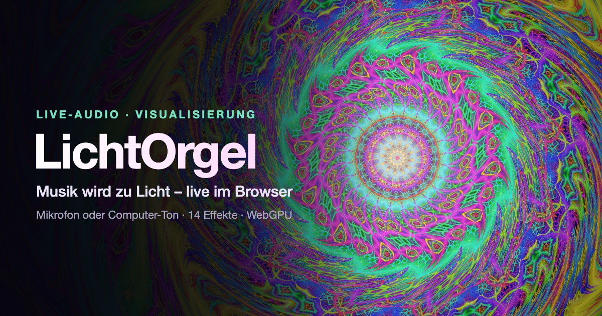

# LichtOrgel



Eine Lichtorgel im Browser: Audio von im Browser erzeugten Synthesizer-Loops, Mikrofon, Computer oder einer eigenen Musikdatei wird in zehn Frequenzbänder zerlegt und in Echtzeit als Animation dargestellt. Oberfläche und Stimme gibt es auf Deutsch, Englisch und Italienisch. Die Anwendung ist eine einzelne Datei (`index.html`) ohne Abhängigkeiten und ohne Build-Schritt; dazu kommen Manifest, Service Worker und Icons für die Installation als App.

**Live:** https://helmutqualtinger.github.io/LichtOrgel/

## Starten

Browser erlauben Audiozugriff nur in einem sicheren Kontext (HTTPS oder `localhost`). Lokal genügt ein einfacher Webserver:

```sh
python3 -m http.server 8000
```

Danach `http://localhost:8000` öffnen. Die Seite startet direkt im Auto-Modus mit einem Synthesizer-Loop (Goa-Trance bzw. dem zuletzt gewählten Loop). Browser geben Ton und Sprachausgabe meist erst nach einer Interaktion frei; dann genügt ein Klick irgendwo auf die Seite.

## Als App auf dem Handy

Die LichtOrgel ist eine installierbare Web-App (PWA): eigenes Icon auf dem Home-Bildschirm, Vollbild ohne Browserleiste, offline nutzbar. Eine Installation über App Store oder Play Store ist nicht nötig.

- **iPhone/iPad (Safari):** Seite öffnen → Teilen-Symbol → **„Zum Home-Bildschirm“**.
- **Android (Chrome):** Seite öffnen → Menü ⋮ → **„App installieren“** bzw. „Zum Startbildschirm hinzufügen“.

Updates kommen automatisch: Die App lädt beim Start die neueste Version im Hintergrund und zeigt sie beim nächsten Öffnen.

## Bedienung

Alle Einstellungen befinden sich in der Kopfleiste und werden im Browser gespeichert (der Auto-Modus ist beim Laden immer an).

| Element | Funktion |
|---|---|
| **Quelle** | Synthesizer-Loop, Mikrofon, Eingabegerät, Computer-Ton oder eigene Musikdatei |
| **Start / Stopp** | Audio ein- und ausschalten |
| **Auto** | Geht automatisch der Reihe nach durch Effekte und Farbthemen |
| **Stimme** | Im Auto-Modus spricht eine weibliche Stimme bei jedem Farbwechsel einen Spruch |
| **Flaggenmenü** | Sprache von Oberfläche und Stimme: 🇩🇪 Deutsch, 🇬🇧 English, 🇮🇹 Italiano |
| **Animation** | Effekt wählen (Wechsel mit Überblendung) |
| **Thema** | Farbthema wählen (fließender Übergang) |
| **Klick ins Bild** | Im Mandelbrot-Effekt: angeklickten Punkt als neues Zoomziel wählen |

Unten rechts im Bild stehen das aktive Grafik-Backend und die Bildrate.

### Audioquellen

- **Mikrofon** – Echounterdrückung, Rauschunterdrückung und automatische Verstärkung sind abgeschaltet, damit die Anzeige ohne Verzögerung und mit vollen Pegelspitzen reagiert.
- **Eingabegerät** – jedes erkannte Audio-Eingabegerät. Die Namen erscheinen nach der ersten Mikrofonfreigabe. Ein Loopback-Gerät wie [BlackHole](https://github.com/ExistentialAudio/BlackHole) leitet den Computer-Ton in jedem Browser als Eingang weiter.
- **Computer-Ton** – über die Bildschirm- bzw. Tab-Freigabe; im Dialog **„Audio teilen“** aktivieren. Nur Chrome und Edge; Systemton auf macOS erst in neueren Versionen, Tab-Ton immer. Das Signal wird um 20 dB abgesenkt, da es deutlich lauter ist als ein Mikrofon.

- **Synthesizer-Loops** – psychedelische Musik, die der Browser selbst erzeugt, ohne Dateien oder Server. Die Loops sind generativ und wiederholen sich nie exakt:
  - *Goa-Trance* (145 BPM) – Kick, rollender Bass, Acid-Lead mit Resonanzfilter und Gleittönen, Hi-Hats; 64-Takt-Arrangement mit Breakdown
  - *Raga-Drone* (76 BPM) – Bordun, Tanpura, sitarähnliche Melodie im Raga Bhairav, Tabla im Teental
  - *Kosmische Reise* (96 BPM) – Akkordflächen, Arpeggio im Stil der Berliner Schule mit Filterfahrt, Sub-Bass, Glocken
  - *Dark Psy (Forest)* (152 BPM) – rollender Bass, chromatisches Squelch-Lead, metallische Percussion, Laser-Sweeps
  - *Psy-Dub* (72 BPM) – One-Drop-Beat, Offbeat-Orgelakkorde mit Echo, Dub-Bassline, Sirene
  - *60s-Psychedelic-Orgel* (112 BPM) – Rock-Beat mit Tamburin, Fuzz-Bass, Orgelakkorde und -melodie in Phrygisch-Dur
  - *Krautrock-Motorik* (124 BPM) – Motorik-Beat, treibender Bass, Orgelflächen, Sequenzer-Motiv
  - *Klangschalen-Meditation* – ohne Beat: Om-Bordun, tibetische Klangschalen mit Schwebungen, Windspiel
- **Eigene Musikdatei** – öffnet die Dateiauswahl; die Datei wird lokal im Browser abgespielt und in Schleife wiederholt.

Trennt sich ein Mikrofon (Gerätewechsel, Bluetooth, Ruhezustand), verbindet die Seite automatisch neu und weicht bei Bedarf auf das Standard-Mikrofon aus.

## Effekte

15 Effekte; die mit **GPU** markierten werden als Shader auf der Grafikkarte gerendert.

| Effekt | Darstellung |
|---|---|
| Kreis (GPU) | Radiale Speichen, Bass oben, Höhen unten; der Kern pulsiert mit dem Bass |
| Welle | Drei überlagerte Wellen für Bass, Mitten und Höhen mit Nachleuchten |
| Oszilloskop | Wellenform des Signals, getriggert und automatisch skaliert |
| Tunnel (GPU) | Flug durch einen Tunnel; Ringe und Tempo folgen Spektrum und Bass |
| Partikel | 320 Partikel in einem Strömungsfeld, je eines Frequenzbands |
| Wasserfall | Laufendes Spektrogramm in voller Frequenzauflösung |
| Skyline | 48 aufrechte Balken mit fallenden Spitzenwerten; ihre kräftige, flimmernde Spiegelung fällt um 45° schräg nach rechts unten |
| Blüte | Drei rotierende Rosenkurven für Bass, Mitten und Höhen |
| Sternflug | Warp-Sternenfeld; Tempo nach Lautstärke, Schub bei Bass-Schlägen |
| Galaxie (GPU) | Spiralgalaxie; Bass im Kern, Höhen in den äußeren Armen |
| Kaleidoskop (GPU) | Zehnfach gespiegelt und siebenfach gefaltet, jede Faltung an ein Band gekoppelt |
| Plasma (GPU) | Interferenzmuster; Frequenzen und Tempo aus dem Spektrum |
| Mandelbrot (GPU) | Zoomt bis etwa 10⁻¹⁶ in die Mandelbrot-Menge (oder bis das voll gerenderte Bild zu über 90 % schwarz ist), bremst weich ab, zoomt wieder heraus und schwenkt zum nächsten von sieben Misiurewicz-Punkten (Startpunkt per Zufall aus der Uhrzeit). Ein Klick ins Bild macht den angeklickten Punkt zum neuen Zoomziel, auch in großer Tiefe. 3D-Relief mit Licht von links oben (Normalen aus der mitgeführten Ableitung). Achtstufige Farbtabelle des gewählten Themas (z. B. Hitze bei Glut, Eis bei Ozean, Prisma, Gift), die linear 2-mal über den jeweils sichtbaren Iterationsbereich läuft; der Ton verschiebt die Palette (Tonhöhe als spektraler Schwerpunkt, Lautstärke, weich abklingender Schub bei Bass-Schlägen), die Helligkeit bleibt konstant. Wo die Struktur feiner als ein Pixel ist, steht statt Farbrauschen eine ruhige Mittelfarbe (Distanzschätzung). Referenz-Orbit mit BigInt-Genauigkeit auf der CPU, Pixel per Perturbation auf der GPU, Auflösung passt sich der Bildrate an |
| Terrain | 3D-Gitterlandschaft aus dem Spektrumsverlauf mit Sonne am Horizont |
| Blitze | Blitzeinschläge bei Bass-Schlägen und Spitzen in den Höhen |

Farbthemen: **Neon**, **Glut**, **Ozean**, **Aurora**, **Mono**, **Prisma**, **Gift** sowie die in der Fraktal- und Datengrafik üblichen Farbtabellen **Klassik** (Ultra-Fractal-Standard), **Viridis**, **Inferno**, **Twilight** und **Turbo** (aus matplotlib). Jedes Thema hat eine eigene achtstufige Farbtabelle für den Mandelbrot-Effekt.

Bei jedem Bass-Schlag hellt sich das Bild kurz auf.

## Auto-Modus

Im Auto-Modus wechselt der Effekt alle 20 Sekunden zum nächsten in Menüreihenfolge, jeweils auf dem nächsten Bass-Schlag. Für 2,5 Sekunden laufen alter und neuer Effekt gleichzeitig und werden überblendet. Das Farbthema wechselt alle 12 Sekunden mit einer Überblendung von 4 Sekunden. Der Auto-Modus läuft nur bei aktivem Audio.

Mit eingeschalteter **Stimme** spricht eine weibliche Stimme bei jedem Farbwechsel langsam einen von 31 psychedelischen Sprüchen in der gewählten Sprache, eingeblendet als Untertitel. Die Reihenfolge ist zufällig; jeder Spruch kommt einmal, bevor neu gemischt wird. Verwendet wird die Sprachausgabe des Browsers; auf dem Mac bevorzugt „Petra (Premium)“ (Deutsch), „Samantha“ (Englisch) und „Alice“ (Italienisch).

## Grafik-Backends

Die Seite wählt automatisch: **WebGL2** → **WebGPU** → **Canvas 2D**. WebGL2 ist Standard, weil es mit diesen Shadern spürbar schneller ist als WebGPU; WebGPU lässt sich per `?gpu=webgpu` erzwingen. Ohne GPU-Unterstützung laufen alle Effekte als Canvas-2D-Varianten.

Zum Testen lässt sich ein Backend per URL-Parameter erzwingen:

```
index.html?gpu=webgpu
index.html?gpu=webgl
index.html?gpu=off
```

## Datenschutz

Das Audiosignal wird ausschließlich lokal im Browser verarbeitet. Es werden keine Daten übertragen oder gespeichert, außer den Einstellungen im `localStorage` des Browsers.

## Dateien

| Datei | Inhalt |
|---|---|
| `index.html` | Die komplette Anwendung (HTML, CSS, JavaScript, Shader) |
| `og-image.jpg` | Vorschaubild für soziale Medien (1200 × 630) |
| `manifest.webmanifest` | App-Beschreibung für die Installation (Name, Icons, Vollbild) |
| `sw.js` | Service Worker für den Offline-Betrieb |
| `icon-*.png`, `apple-touch-icon.png` | App-Icons (Android, iOS, maskierbar) |
| `CLAUDE.md` | Architekturhinweise für die Weiterentwicklung |
